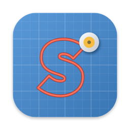

<p align="center">
  
</p>

<h1 align="center">Schnittwerk</h1>

<p align="center">
  Native macOS-App zum Gestalten und Schneiden auf Silhouette-Schneideplottern –<br>
  ein schlanker Ersatz für Silhouette Studio.<br>
  <a href="README.md">English</a> · <b>Deutsch</b>
</p>

> Kein Produkt von Silhouette America, Inc. „Silhouette“, „Cameo“ und „Portrait“ sind Marken ihrer Inhaber.

## Download

Das aktuelle DMG gibt es unter [GitHub Releases](https://github.com/ManuelW77/Schnittwerk/releases). Öffnen und
Schnittwerk in den Programme-Ordner ziehen. Die App ist signiert und von Apple notarisiert.

- macOS 26 oder neuer, Apple silicon (arm64)
- Schnittwerk fragt einmal am Tag bei GitHub nach einer neuen Version und gibt Bescheid (abschaltbar unter
  Einstellungen → Updates, oder von Hand: Schnittwerk → Nach Updates suchen …)

## Unterstützte Plotter

| Verbindung | Modelle |
|---|---|
| USB | Cameo 4, Cameo 4 Plus, Cameo 4 Pro, Cameo 5, Cameo 5 Plus, Cameo 5 Alpha, Cameo 5 Alpha Plus, Cameo Pro MK-II, Portrait 3, Portrait 4 |
| USB, eigener Befehlssatz | Cameo 3 (am Gerät getestet) |
| USB (experimentell, eigener Befehlssatz) | Cameo 2, Cameo, Portrait 2, Portrait, Craft Robo CC200-20 |
| Bluetooth (experimentell) | Cameo 3 (vorher in den Systemeinstellungen koppeln), Cameo 4, Cameo 4 Plus, Cameo 4 Pro |

Getestet an einem echten **Cameo 3**. Die anderen Modelle wurden nach dem Open-Source-Projekt
[inkscape-silhouette](https://github.com/fablabnbg/inkscape-silhouette) ergänzt. Cameo 3 und ältere Geräte
bekommen eigene Befehle und schneiden höchstens mit Geschwindigkeit 10; ältere Geräte haben nur einen
Werkzeughalter und keine AutoBlade-Tiefe. Mach dort zuerst einen Testschnitt. Rückmeldungen von Besitzern sind willkommen. Die Verbindung wählst du im
Schneiden-Bereich: *Automatisch* versucht zuerst USB, dann Bluetooth. Per Bluetooth darf der Plotter nicht
gleichzeitig mit einer anderen App verbunden sein.

## Funktionen

### Importieren und Nachzeichnen
- **SVG**, **DXF** und **PDF** importieren (Button, Drag & Drop oder Ablage → Öffnen für SVG/DXF)
- **Aus anderen Apps einfügen** mit ⌘V: Zeichnung in Affinity, Illustrator, Inkscape, Figma … kopieren und auf der
  Matte einfügen – ohne vorher eine Datei zu speichern. Bietet die App SVG an, wird das genommen, sonst das PDF aus
  der Zwischenablage. Zeichnungen lassen sich auch direkt aus einer anderen App auf die Matte ziehen. Text vorher in
  Kurven umwandeln.
- **Bilder nachzeichnen** (PNG, JPG, HEIC …) als Schnittlinien, mit Live-Vorschau:
  - *Umriss*: eine Schnittlinie um das Motiv, nach Helligkeits-Schwellwert oder nach Transparenz (ideal für Logos)
  - *Farben*: das Bild wird auf 2–8 Farben reduziert; jede Farbe wird eine eigene, farbige Ebene, z. B. für
    Folie in mehreren Farben. Farben lassen sich zu einer Ebene zusammenlegen, der Hintergrund wird erkannt, und
    der Umriss des ganzen Motivs kann als Grundebene dazukommen
  - Glätten mit erhaltenen spitzen Ecken, kleine Flecken entfernen, Größe in mm

### Zeichnen und Text
- Werkzeuge: **Auswählen**, **Text**, **Freihand**, **Kurve** (Stift: Klick setzt Ecken, Ziehen runde Punkte)
- Text aus allen Mac-Schriften als Schnittlinien; Doppelklick auf einen Text bearbeitet ihn
- Grundformen: Rechteck (runde Ecken), Ellipse, Vieleck, Stern – nachträglich änderbar

### Bearbeiten
- Verschieben, skalieren, drehen, spiegeln; genaue Position und Größe im Inspektor
- Mehrfachauswahl mit ⇧/⌘-Klick oder Auswahlrahmen
- Verschmelzen, Abziehen, Schnittmenge
- Kontur nach außen oder innen, runde oder spitze Ecken (z. B. für Sticker)
- Ausrichten und Verteilen
- Objekte **gruppieren**, damit sie sich gemeinsam bewegen, und **sperren**, damit sie nicht verändert werden
- Kontextmenü (Rechtsklick) mit den Aktionen, die zur Auswahl passen
- Rückgängig und Wiederholen mit Buttons in der Werkzeugleiste und ⌘Z / ⇧⌘Z

### Matte und Ansicht
- Matte 12 × 12 Zoll, 12 × 24 Zoll oder Rolle ohne Matte
- Zoomen mit Pinch, ⌘ oder ⌥ + Scrollrad (um den Mauszeiger) oder über die Werkzeugleiste
- Ansicht verschieben mit Leertaste + Ziehen oder mittlerer Maustaste

### Schneiden
- Werkzeug, Klingentiefe, Kraft, Geschwindigkeit, Durchgänge
- Material-Vorlagen und eigene Schnittprofile (Import / Export als `.schnittprofile`)
- Testschnitt, Verbindung prüfen, Plotter-Befehle als Text exportieren
- Objekte lassen sich vom Schneiden ausnehmen; Linien außerhalb des Schneidbereichs werden gemeldet

### Dateien
- Projekte werden als `.schnittwerk` gespeichert; SVG- und DXF-Dateien werden nie überschrieben
- Projekte und Schnittprofile zeigen im Finder das Schnittwerk-Icon
- Die App startet mit einer leeren Matte; eine geöffnete Datei ersetzt ein unbenutztes leeres Fenster

### KI-Gestaltung über MCP
Schnittwerk hat einen eingebauten [MCP](https://modelcontextprotocol.io)-Server, damit ein KI-Assistent auf der
Matte gestalten kann. Standardmäßig aus. Einschalten unter Einstellungen → KI (MCP); er ist nur auf `127.0.0.1`
erreichbar und braucht einen geheimen Schlüssel (`Authorization: Bearer …`). Den fertigen Befehl kopierst du aus
diesem Einstellungs-Tab, er sieht so aus:

```bash
claude mcp add --transport http --scope user schnittwerk http://127.0.0.1:39170/mcp --header "Authorization: Bearer <Schlüssel>"
```

Werkzeuge: `get_document`, `render_preview`, `add_svg`, `add_text`, `add_shape`, `update_object`,
`delete_objects`, `duplicate_objects`, `combine`, `add_offset`, `arrange`, `set_mat`, `list_fonts`,
`new_document`. Sie arbeiten im vordersten Projektfenster; jede Änderung ist ein Rückgängig-Schritt (⌘Z).
Gesperrte Objekte bleiben unverändert, und Schneiden ist über MCP nicht möglich.

## Tastenkürzel

| Tasten | Wirkung |
|---|---|
| V · T · F · P | Werkzeug Auswählen · Text · Freihand · Kurve (auf der Matte) |
| ⌘T | Text-Werkzeug |
| ⌘I · ⇧⌘I | SVG/DXF/PDF importieren · Bild nachzeichnen |
| ⌘V | Zeichnung aus einer anderen App einfügen |
| ⌘D · ⌫ | Duplizieren · Löschen |
| ⌘G · ⇧⌘G | Gruppieren · Gruppierung aufheben |
| ⌘L · ⌥⌘L | Sperren · Alle entsperren |
| ⌘Z · ⇧⌘Z | Rückgängig · Wiederholen |
| ⌘+ · ⌘− · ⌘0 | Vergrößern · Verkleinern · 100 % |
| Pfeiltasten (⇧) | 1 mm (10 mm) verschieben |
| ⇧ beim Ziehen | gerade verschieben; in 15°-Schritten drehen |
| Return · Esc · ⌫ | Kurven-Werkzeug: beenden · beenden · letzten Punkt entfernen |
| ⌘Return | Schneiden |

Sprachen: English, Deutsch.

## Selbst bauen

Voraussetzungen: macOS 26+ auf Apple silicon, Xcode, [XcodeGen](https://github.com/yonaskolb/XcodeGen), libusb
(`brew install xcodegen libusb`). libusb wird statisch eingebunden, die gebaute App läuft ohne Homebrew.

```bash
xcodegen generate
xcodebuild -project Schnittwerk.xcodeproj -scheme Schnittwerk -derivedDataPath build build
```

- Tests: `xcodebuild test -project Schnittwerk.xcodeproj -scheme Schnittwerk -derivedDataPath build`
- Übersetzungen: `tools/l10n/de.json` bearbeiten, dann `python3 tools/l10n/build_catalogs.py`
- Release (signiertes, notarisiertes DMG auf GitHub): siehe [tools/release/README.md](tools/release/README.md)

## Branches

- `main` – veröffentlichter Stand
- `devel` – zum Testen
- `feature/…` – ein Branch pro Funktion, zum Testen in `devel` gemergt

## Lizenz

GPL-3.0-or-later, siehe [LICENSE](LICENSE).

Protokoll-Details stammen aus Open-Source-Projekten; es wurde kein Code übernommen:
[inkscape-silhouette](https://github.com/fablabnbg/inkscape-silhouette) (USB-Befehle und Modellliste) und
[Inkcut](https://github.com/inkcut/inkcut/pull/441) (Bluetooth LE des Cameo 4).
