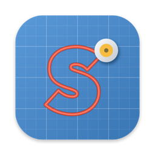

<p align="center">
  
</p>

<h1 align="center">Schnittwerk</h1>

<p align="center">
  Native macOS app for designing and cutting on Silhouette cutting plotters –<br>
  a lean alternative to Silhouette Studio.<br>
  <b>English</b> · <a href="README.de.md">Deutsch</a>
</p>

> Not affiliated with Silhouette America, Inc. "Silhouette", "Cameo" and "Portrait" are trademarks of their owners.

## Download

Get the latest DMG from [GitHub Releases](https://github.com/ManuelW77/Schnittwerk/releases), open it and drag
Schnittwerk into Applications. The app is signed and notarized by Apple.

- macOS 26 or newer, Apple silicon (arm64)
- Schnittwerk checks GitHub once a day for a new version and tells you (can be turned off in Settings → Updates,
  or check by hand: Schnittwerk → Check for Updates …)

## Supported plotters

| Connection | Models |
|---|---|
| USB | Cameo 4, Cameo 4 Plus, Cameo 4 Pro, Cameo 5, Cameo 5 Plus, Cameo 5 Alpha, Cameo 5 Alpha Plus, Cameo Pro MK-II, Portrait 3, Portrait 4 |
| USB, own command set | Cameo 3 (tested on the machine) |
| USB (experimental, own command set) | Cameo 2, Cameo, Portrait 2, Portrait, Craft Robo CC200-20 |
| Bluetooth (experimental) | Cameo 4, Cameo 4 Plus, Cameo 4 Pro |

Tested on a real **Cameo 4**. The other models were added following the open-source project
[inkscape-silhouette](https://github.com/fablabnbg/inkscape-silhouette). The Cameo 3 and older machines get their
own commands and cut at speed 10 at most; older machines have one tool holder and no AutoBlade depth. Run a test
cut there first. feedback from owners is welcome. Choose the connection in the Cut panel: *Automatic* tries USB
first, then Bluetooth. Over Bluetooth, the plotter must not be connected to another app at the same time.

## Features

### Import and tracing
- Import **SVG**, **DXF** and **PDF** (button, drag & drop, or File → Open for SVG/DXF)
- **Paste from other apps** with ⌘V: copy a drawing in Affinity, Illustrator, Inkscape, Figma … and paste it on the
  mat – no need to save a file first. SVG is used when the app offers it, otherwise the PDF on the clipboard.
  Drawings can also be dragged straight from another app onto the mat. Convert text to curves first.
- **Trace images** (PNG, JPG, HEIC, …) into cut lines, with live preview:
  - *Outline*: one cut line around the motif, by brightness threshold or by transparency (great for logos)
  - *Colours*: the image is reduced to 2–8 colours; each colour becomes its own coloured layer, e.g. for vinyl in
    several colours. Colours can be merged into one layer, the background is detected, and an outline of the whole
    motif can be added as a base layer
  - Smoothing that keeps sharp corners, removal of small specks, size in mm

### Drawing and text
- Tools: **Select**, **Text**, **Freehand**, **Curve** (pen tool: click for corners, drag for round points)
- Text from all Mac fonts as cut lines; double-click a text to edit it
- Basic shapes: rectangle (rounded corners), ellipse, polygon, star – editable afterwards

### Editing
- Move, scale, rotate, mirror; exact position and size in the inspector
- Multiple selection with shift/⌘ click or rubber band
- Weld, subtract, intersect
- Offset outwards or inwards, round or sharp corners (e.g. sticker outlines)
- Align and distribute
- **Group** objects so they move together, **lock** objects so they cannot be changed
- Context menu (right click) with the actions that fit the selection
- Undo and redo with toolbar buttons and ⌘Z / ⇧⌘Z

### Mat and navigation
- Mat 12 × 12 in, 12 × 24 in, or roll without mat
- Zoom with pinch, ⌘ or ⌥ + scroll wheel (around the pointer), or the toolbar
- Move the view with space + drag or the middle mouse button

### Cutting
- Tool, blade depth, force, speed, passes
- Material presets and your own cut profiles (import / export as `.schnittprofile`)
- Test cut, connection check, export of the plotter commands as text
- Objects can be excluded from cutting; lines outside the cutting area are reported

### Files
- Projects are saved as `.schnittwerk`; SVG and DXF files are never overwritten
- Projects and cut profiles show the Schnittwerk icon in Finder
- The app starts with an empty mat; opening a file replaces an unused empty window

### AI design via MCP
Schnittwerk has a built-in [MCP](https://modelcontextprotocol.io) server, so an AI assistant can design on the mat.
Off by default. Turn it on in Settings → AI (MCP); it listens on `127.0.0.1` only and needs a secret key
(`Authorization: Bearer …`). Copy the ready-made command from that settings tab, it looks like this:

```bash
claude mcp add --transport http --scope user schnittwerk http://127.0.0.1:39170/mcp --header "Authorization: Bearer <key>"
```

Tools: `get_document`, `render_preview`, `add_svg`, `add_text`, `add_shape`, `update_object`, `delete_objects`,
`duplicate_objects`, `combine`, `add_offset`, `arrange`, `set_mat`, `list_fonts`, `new_document`.
They work on the front project window; every change is one undo step (⌘Z). Locked objects are not changed,
and cutting is not available through MCP.

## Keyboard shortcuts

| Keys | Action |
|---|---|
| V · T · F · P | Select · Text · Freehand · Curve tool (on the mat) |
| ⌘T | Text tool |
| ⌘I · ⇧⌘I | Import SVG/DXF/PDF · Trace image |
| ⌘V | Paste a drawing from another app |
| ⌘D · ⌫ | Duplicate · Delete |
| ⌘G · ⇧⌘G | Group · Ungroup |
| ⌘L · ⌥⌘L | Lock · Unlock all |
| ⌘Z · ⇧⌘Z | Undo · Redo |
| ⌘+ · ⌘− · ⌘0 | Zoom in · out · 100 % |
| Arrow keys (⇧) | Move by 1 mm (10 mm) |
| ⇧ while dragging | Move straight; rotate in 15° steps |
| Return · Esc · ⌫ | Curve tool: finish · finish · remove last point |
| ⌘Return | Cut |

Languages: English, Deutsch.

## Build

Requirements: macOS 26+ on Apple silicon, Xcode, [XcodeGen](https://github.com/yonaskolb/XcodeGen), libusb
(`brew install xcodegen libusb`). libusb is linked statically, so the built app runs without Homebrew.

```bash
xcodegen generate
xcodebuild -project Schnittwerk.xcodeproj -scheme Schnittwerk -derivedDataPath build build
```

- Tests: `xcodebuild test -project Schnittwerk.xcodeproj -scheme Schnittwerk -derivedDataPath build`
- Translations: edit `tools/l10n/de.json`, then run `python3 tools/l10n/build_catalogs.py`
- Release (signed, notarized DMG on GitHub): see [tools/release/README.md](tools/release/README.md)

## Branches

- `main` – released state
- `devel` – testing
- `feature/…` – one branch per feature, merged into `devel` for testing

## License

GPL-3.0-or-later, see [LICENSE](LICENSE).

Protocol details were learned from open-source projects; no code was copied:
[inkscape-silhouette](https://github.com/fablabnbg/inkscape-silhouette) (USB commands and model list) and
[Inkcut](https://github.com/inkcut/inkcut/pull/441) (Bluetooth LE of the Cameo 4).
